<div align="center">


[](https://github.com/dcastillosaez/Simulador-Electrocardiograma/actions/workflows/tests.yml)
[](LICENSE)
[](https://www.python.org/)
[](https://react.dev/)
[](https://tauri.app/)
[](docs/requisitos-del-sistema.md#0-uso-previsto-y-aviso-regulatorio)

**[Qué hace](#qué-hace)** · **[Ritmos](#doce-ritmos-y-un-paciente-a-medida)** · **[Fármacos](#quince-fármacos)** · **[Arquitectura](#cómo-está-construido)** · **[Arrancarlo](#ponerlo-en-marcha)** · **[Documentación](#documentación)**

</div>

Este proyecto no dibuja ondas: las genera. Un motor fisiológico produce la señal de las doce derivaciones, un motor farmacológico cambia el estado del paciente cuando le pones un medicamento y un corazón 3D late con el mismo reloj que el trazado. Todo eso se maneja desde un puesto de simulación pensado para aprender a leer un ECG delante de algo que responde.

> [!WARNING]
> **Es un simulador formativo.** No es un dispositivo médico ni sirve para diagnosticar o tratar a nadie. El paciente es sintético y la señal sale de un motor. El aviso viaja con el producto: se ve en la barra de estado y queda estampado dentro de cada PNG exportado.

<p align="center">
  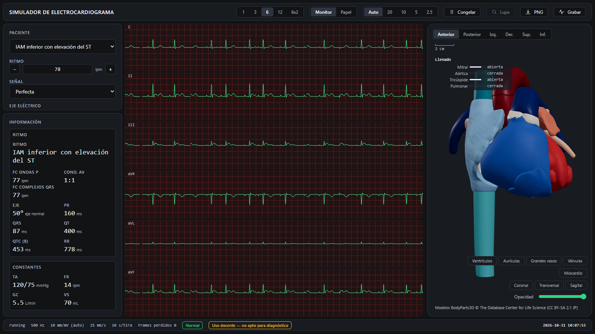
  <br>
  <sub>Un IAM inferior en vista de monitor. Elevación del ST en II, III y aVF, medidas en vivo y las cuatro válvulas siguiendo el ciclo.</sub>
</p>

## Qué hace

<table>
<tr>
<td width="50%" valign="top">

**📈 Señal de verdad, no un dibujo**<br>
Doce derivaciones a 500 Hz. Los intervalos se cumplen: si pides un QRS de 140 ms, la medida sobre la señal da 140.

</td>
<td width="50%" valign="top">

**💊 Fármacos que actúan sobre el paciente**<br>
Curvas de concentración, efectos, acumulación e interacciones. Cada dosis entra por el mando fisiológico que le corresponde.

</td>
</tr>
<tr>
<td valign="top">

**🫀 Corazón 3D sincronizado**<br>
Modelo anatómico con válvulas cuyo ciclo manda el servidor. Una fibrilación auricular se lleva por delante la sístole auricular sin ningún caso especial.

</td>
<td valign="top">

**📏 Medición como en la consulta**<br>
Congela el trazado y mide con regla, calibre y RR. Lupa, papel a 25, 50 o 100 mm/s y enganche a la señal, a la rejilla o al pico R.

</td>
</tr>
<tr>
<td valign="top">

**🧑‍⚕️ Pacientes a medida**<br>
Un editor con todos los parámetros eléctricos y hemodinámicos, y una biblioteca para guardar y recuperar los casos por nombre.

</td>
<td valign="top">

**🖥️ Web o escritorio**<br>
Se usa en el navegador o como aplicación de Windows con Tauri 2. El instalador lleva dentro Python y la base de datos, sin pedir permisos de administrador.

</td>
</tr>
</table>

<table>
<tr>
<td width="50%" align="center">
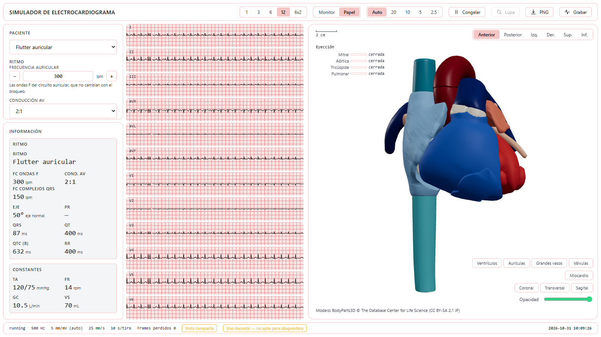<br>
<sub><b>Vista de papel.</b> Flutter 2:1 en doce derivaciones, con la aurícula y el bloqueo como mandos propios.</sub>
</td>
<td width="50%" align="center">
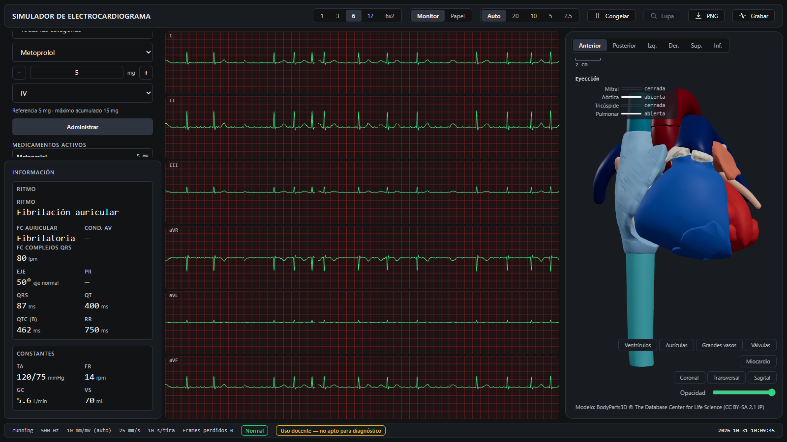<br>
<sub><b>Farmacología.</b> Metoprolol sobre una fibrilación auricular, administrado en el reloj de la simulación.</sub>
</td>
</tr>
</table>

## Doce ritmos y un paciente a medida

Estos trazados son la salida directa del motor en formato de papel, a 25 mm/s y 10 mm/mV. Se regeneran con un solo comando, sin levantar nada más.

<table>
<tr>
<td align="center"><br><sub>Ritmo sinusal normal</sub></td>
<td align="center">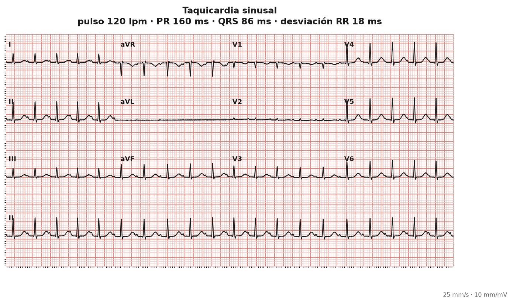<br><sub>Taquicardia sinusal</sub></td>
<td align="center">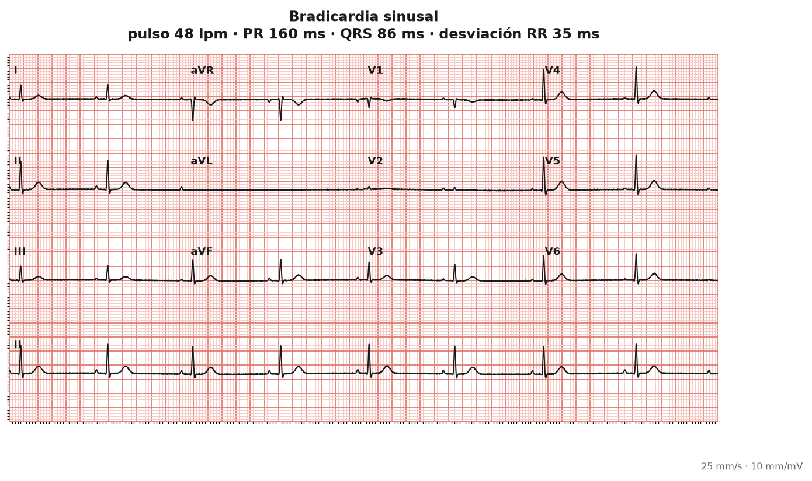<br><sub>Bradicardia sinusal</sub></td>
</tr>
<tr>
<td align="center">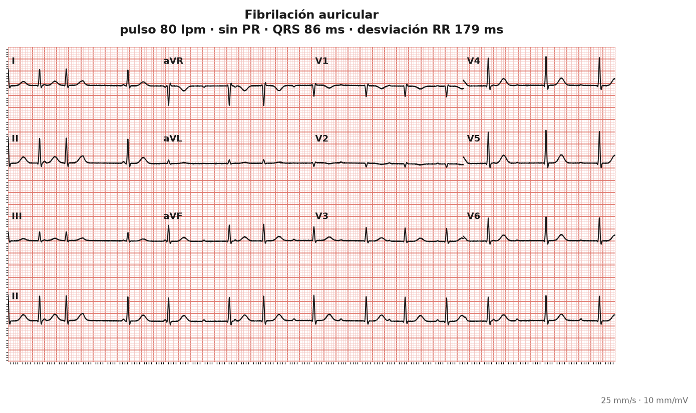<br><sub>Fibrilación auricular</sub></td>
<td align="center">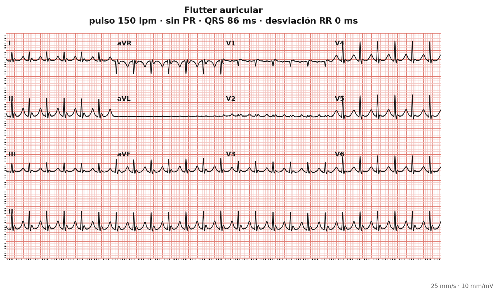<br><sub>Flutter auricular</sub></td>
<td align="center">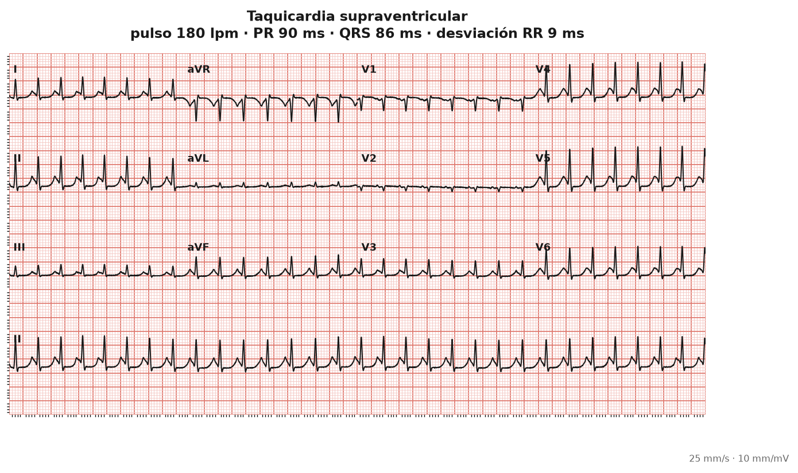<br><sub>Taquicardia supraventricular</sub></td>
</tr>
<tr>
<td align="center">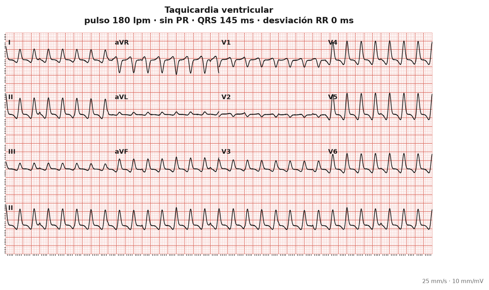<br><sub>Taquicardia ventricular</sub></td>
<td align="center">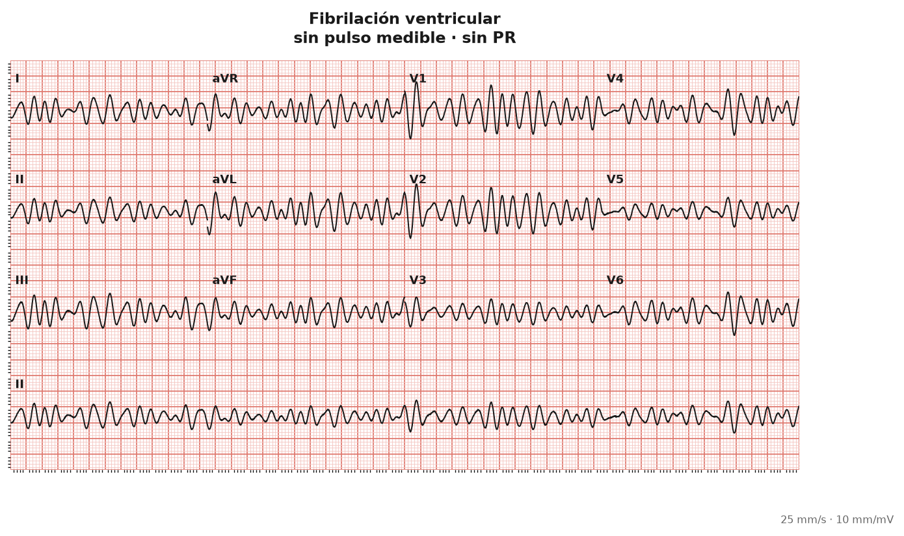<br><sub>Fibrilación ventricular</sub></td>
<td align="center">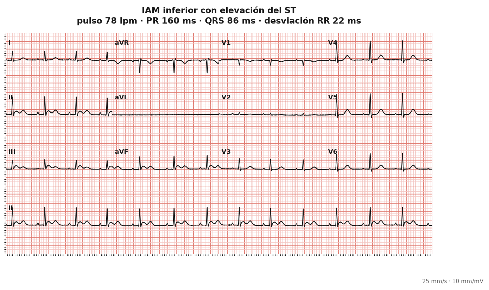<br><sub>IAM inferior con elevación del ST</sub></td>
</tr>
<tr>
<td align="center">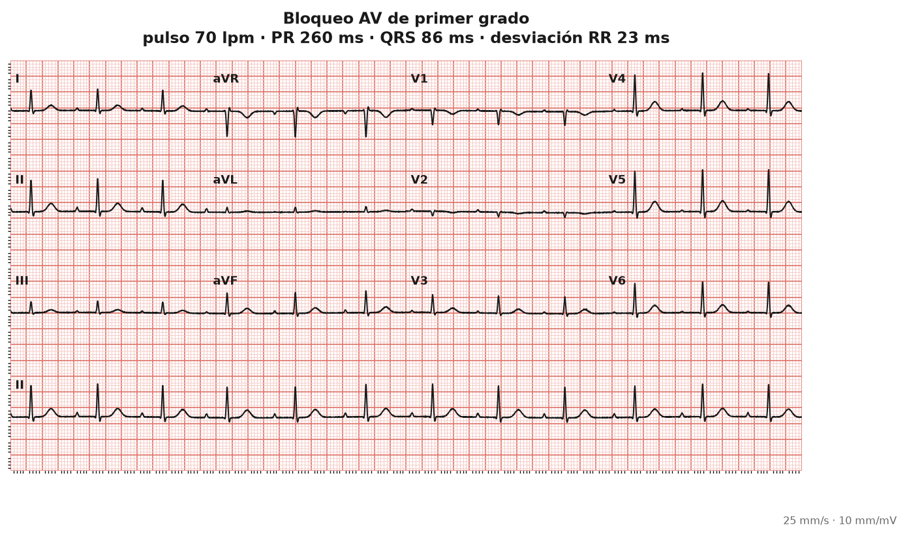<br><sub>Bloqueo AV de primer grado</sub></td>
<td align="center">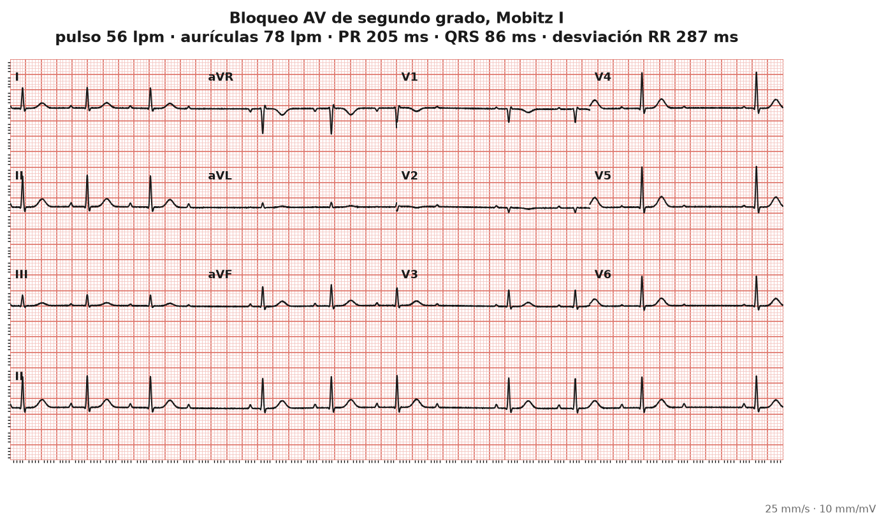<br><sub>Bloqueo AV de segundo grado, Mobitz I</sub></td>
<td align="center">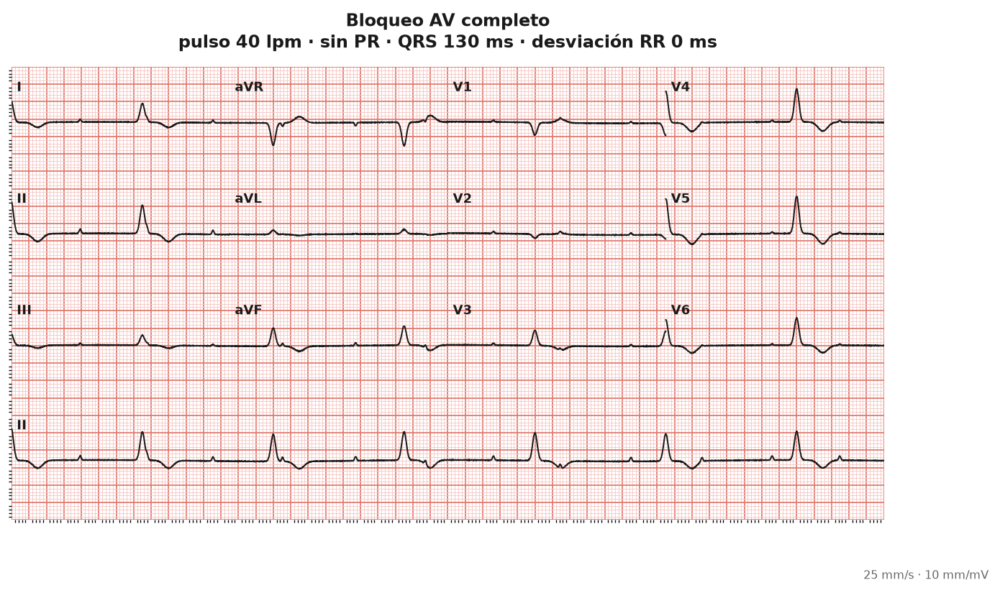<br><sub>Bloqueo AV completo</sub></td>
</tr>
</table>

A estos doce se suma `custom_patient`, que no es un ritmo sino un hueco para el tuyo: la parte eléctrica va al motor de señal y la hemodinámica al basal farmacológico.

## Quince fármacos

| Grupo | Moléculas |
|---|---|
| **Antiarrítmicos** | Adenosina, amiodarona, digoxina, lidocaína, procainamida |
| **Betabloqueantes** | Esmolol, metoprolol |
| **Antagonistas del calcio** | Diltiazem, verapamilo |
| **Simpaticomiméticos** | Adrenalina, dobutamina, dopamina, noradrenalina |
| **Parasimpaticolíticos** | Atropina |
| **Electrolitos** | Sulfato de magnesio |

Añadir una molécula es añadir un YAML en [`catalog/data/`](packages/pharmacology-engine/src/pharmacology_engine/catalog/data/). Si alguna vez obligara a tocar código fuera de ahí, la arquitectura habría fallado.

## Cómo está construido

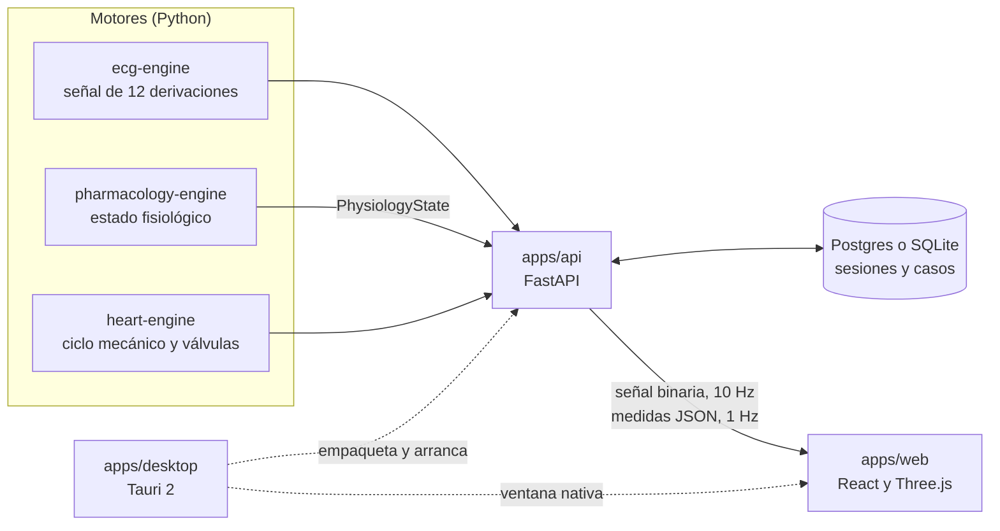

Los motores no se conocen entre sí. La farmacología solo publica un `PhysiologyState`, y un único módulo lo traduce a parámetros de señal; hay un test que lee los imports para que siga siendo así. La lógica clínica vive en catálogos, especificaciones y tests, nunca repartida por la interfaz, y la aplicación arranca aunque no haya base de datos: `/api/health` lo declara y solo se pierde la persistencia.

Cada cambio en la señal de un ritmo es intencional o es una regresión, y las *golden signals* en tres niveles se encargan de que no haya una tercera opción. La red de pruebas supera los 1 200 casos entre Python, Vitest, Playwright y Rust, y la API se prueba contra Postgres y contra SQLite con la misma batería.

```text
apps/
├── api/                  API REST y WebSocket
├── desktop/              Envoltura de escritorio (Tauri 2 y Rust)
└── web/                  Puesto de simulación
packages/
├── ecg-engine/           Motor de señal
├── heart-engine/         Motor mecánico
├── pharmacology-engine/  Motor farmacológico
└── ui-system/            Sistema de diseño
docs/                     Requisitos, instalación y decisiones por fases
deploy/                   Lo necesario para salir de localhost
```

## Ponerlo en marcha

Necesitas Windows, [uv](https://docs.astral.sh/uv/), Node 20 y [Docker Desktop](https://www.docker.com/products/docker-desktop/). Con eso, un solo comando levanta Postgres, aplica las migraciones, arranca API y frontend y abre el navegador:

```bash
arrancar.bat
```

El puesto queda en <http://localhost:5600> y la API en <http://localhost:8200>. Para apagar el contenedor, que es lo único que sigue en segundo plano al cerrar las ventanas:

```bash
parar.bat
```

> [!NOTE]
> Los puertos no son los habituales a propósito: el 5173 de Vite y el rango 7990-8089 caen en bloques que Windows reserva para Hyper-V y Docker. Si ves `WinError 10013`, elige otro con `set PUERTO_API=8686` antes de arrancar.

<details>
<summary><b>Aplicación de escritorio</b></summary>

```bash
cd apps/desktop && npm run dev
```

Para generar el instalador, `npm run build` en esa misma carpeta. Todavía no hay ninguna versión publicada en Releases; cuando la haya, [docs/instalacion.md](docs/instalacion.md) explica cómo comprobar la huella y la procedencia del instalador.

</details>

<details>
<summary><b>Ver lo que produce el motor sin montar nada más</b></summary>

```bash
cd packages/ecg-engine && uv run --extra viz python tools/render_rhythms.py
```

Escribe los trazados en formato de papel en `packages/ecg-engine/tools/output/`. Es la forma más rápida de poner los ritmos delante de un cardiólogo para que los revise.

</details>

<details>
<summary><b>Qué no hace todavía</b></summary>

Faltan del catálogo clínico los bloqueos de rama, la pericarditis, las alteraciones del potasio y del calcio, el WPW y las torsades. Tampoco hay evaluación automática del alumno ni editor de escenarios. La farmacocinética es deliberadamente de una sola curva, sin compartimentos ni aclaramiento renal, y las doce derivaciones salen de tablas de coeficientes por eje en lugar de un dipolo 3D. La lista completa, con sus razones, está en la [sección 10 de los requisitos](docs/requisitos-del-sistema.md#10-fuera-de-alcance-y-limitaciones-conocidas).

Del lado de la distribución, el código de firma, actualizaciones y licencias está escrito y probado, pero falta comprar un certificado, disponer de un servidor y un emisor de licencias.

</details>

## Documentación

| Documento | Para qué sirve |
|---|---|
| [Requisitos del sistema](docs/requisitos-del-sistema.md) | Qué hace la aplicación, con qué fundamento y qué test lo demuestra |
| [Instalación en Windows](docs/instalacion.md) | Instalar y verificar el programa, también para un departamento de informática |
| [Arquitectura de escritorio](docs/fase-g/arquitectura.md) | El qué y el porqué de la aplicación Tauri |
| [Estado de la fase de escritorio](docs/fase-g/estado.md) | Qué está hecho y qué depende de terceros |
| [Válvulas cardíacas](docs/fase-d/valvulas.md) | El ciclo de las cuatro válvulas y cómo se sintetizaron las poses |
| [Despliegue en red](deploy/README.md) | Qué cambia cuando alguien se conecta desde otro equipo |
| [Política de seguridad](SECURITY.md) | Cómo comunicar una vulnerabilidad |

## Licencia y atribución

El código se distribuye bajo [Apache 2.0](LICENSE). El modelo anatómico `apps/web/public/models/heart.glb` es una obra derivada con licencia propia, CC BY-SA 2.1 Japón:

> BodyParts3D, Copyright© The Database Center for Life Science licensed by CC Attribution-Share Alike 2.1 Japan.

El detalle de qué se derivó y qué obliga la licencia está en [docs/fase-d/attribution.md](docs/fase-d/attribution.md).
